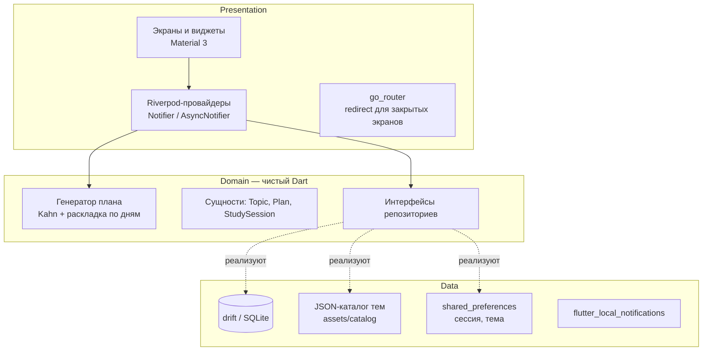
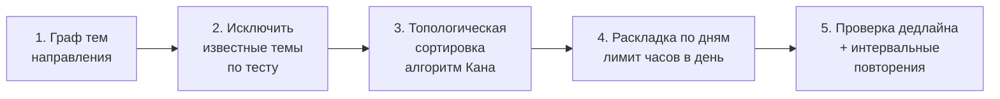

# Защита концепции: тексты слайдов и речь

Проект: **«Маршрут» — мобильное приложение для автоматического формирования персонального плана обучения.**
Дисциплина: ПМ07. Разработка мобильных приложений. Регламент: 5 минут доклад + 3 минуты вопросы, 7 слайдов.

Ориентир по времени: слайды 1–2 по 30 секунд, слайды 3–6 по 50 секунд, слайд 7 — 30 секунд.

---

## Слайд 1. Проблема и целевая аудитория

**На слайде**

- Заголовок: «Маршрут: план обучения, который строится сам»
- Проблема: человек решает «выучить Flutter / Python / английский», но не знает, *с чего начать, в каком порядке идти и успеет ли к сроку*.
- Три боли (иконки):
  1. Хаос в материалах: непонятен порядок тем.
  2. Нет учёта личного времени и уже имеющихся знаний.
  3. Отставание от плана → план «ломается» → человек бросает.
- Целевая аудитория: студенты колледжей и вузов, самоучки, люди, которые меняют профессию.
- Ключевой сценарий: «Выбрал направление → прошёл тест → указал время и дедлайн → получил план по дням».

**Речь**

> Здравствуйте. Моя тема — создание приложения для автоматического формирования персонального плана обучения. Проблема, которую я решаю, знакома каждому студенту: когда вы решаете выучить, например, Flutter, вы видите сотни статей и курсов, но не понимаете, в каком порядке их проходить, сколько это займёт и успеете ли вы к сессии. Готовые курсы не учитывают, что вы уже знаете, и сколько у вас свободного времени. А как только вы пропускаете пару дней, расписание теряет смысл, и мотивация пропадает. Моя целевая аудитория — студенты и самоучки, которые учатся самостоятельно. Главный сценарий: выбрал направление, прошёл короткий тест, указал свои часы и дедлайн — и получил готовый план по дням.

---

## Слайд 2. Анализ конкурентов

**На слайде** — таблица сравнения:

| Возможность | roadmap.sh | Duolingo | Stepik / Coursera | Notion / Todoist | **Маршрут** |
|---|---|---|---|---|---|
| Порядок тем (граф зависимостей) | да, статичная схема | внутри курса | внутри курса | нет | **да, автоматически** |
| Учёт уже имеющихся знаний | нет | частично (тест уровня) | нет | нет | **да, диагностический тест** |
| План по дням под личное время | нет | ежедневная цель | дедлайны курса | вручную | **да** |
| Перестройка плана при отставании | нет | нет | нет | вручную | **да, одной кнопкой** |
| Работа без интернета и регистрации в облаке | нет | нет | нет | частично | **да, всё локально** |
| Несколько направлений в одном приложении | да | языки, математика, музыка | да | — | **да** |

> Сведения об аналогах составлены по их публичным описаниям; перед защитой сверить с актуальными версиями сервисов. [ПРОВЕРИТЬ]

Вывод на слайде: «Конкуренты дают *материалы* или *задачник*, но не *персональный маршрут* с перестройкой».

**Речь**

> Я проанализировал аналоги. Сайт roadmap.sh показывает схемы изучения технологий, но схема одинакова для всех: она не строит расписание под ваше время и дедлайн. Duolingo хорошо мотивирует, но набор направлений у него ограничен, и план там задаёт сам сервис. Курсы на Stepik и Coursera задают свой темп, а не ваш. Планировщики вроде Notion или Todoist требуют всё расписать вручную. Моё приложение объединяет сильные стороны: граф тем, как у roadmap.sh, учёт уровня через тест, расписание под ваше время и автоматическую перестройку при отставании. И всё работает офлайн, без облачных сервисов.

---

## Слайд 3. Архитектура и стек

**На слайде** — схема слоёв (Clean Architecture):

Обоснование выбора (коротко на слайде):

| Задача | Выбрано | Альтернативы | Почему |
|---|---|---|---|
| Состояние | **Riverpod 3** | BLoC, Provider | Проверка на этапе компиляции, нет зависимости от BuildContext, легко подменять зависимости в тестах (overrides). BLoC требует много шаблонного кода (Event/State-классы), Provider завязан на дерево виджетов. |
| Хранение | **drift (SQLite)** | Hive, Firebase | Данные реляционные (пользователь → планы → занятия), нужны JOIN, фильтры, сортировки, транзакции. Hive — key-value без связей. Firebase требует облака, ключей и интернета, а проект должен запускаться `flutter run` без них. |
| Навигация | **go_router** | Navigator 1.0 | Декларативные маршруты, `redirect` закрывает экраны для неавторизованных, вкладки через `StatefulShellRoute`. |
| Авторизация | Локальная, SHA-256 + соль | Firebase Auth | Работает офлайн; пароль не хранится в открытом виде. |

**Речь**

> Архитектура построена по принципам Clean Architecture и разделена на три слоя. Слой Domain написан на чистом Dart и не знает о Flutter: здесь сущности и главный алгоритм. Слой Data отвечает за хранение: база SQLite через drift, каталог тем в JSON и настройки. Слой Presentation — экраны и провайдеры Riverpod. Riverpod я выбрал вместо BLoC, потому что он требует меньше шаблонного кода, а зависимости легко подменять в тестах. Вместо Provider — потому что Riverpod не зависит от BuildContext и ловит ошибки на этапе компиляции. Для хранения выбран drift: у меня связанные данные — пользователь, его планы, занятия, заметки, — и мне нужны SQL-запросы с фильтрами. Hive хранит пары ключ-значение без связей, а Firebase требует облака и интернета.

---

## Слайд 4. Алгоритм формирования плана

**На слайде** — 5 шагов конвейера:

- Направление — ориентированный ациклический граф: вершина — тема, ребро «A → B» — «A нужно знать до B».
- Тест: верный ответ по теме → тема и все её предшественники считаются изученными.
- Алгоритм Кана: берём темы без невыполненных зависимостей, при равенстве — по уровню сложности. Сложность O(V + E). Цикл в графе обнаруживается автоматически.
- Раскладка: лимит в день = часы в неделю / число учебных дней; тема дробится на занятия по 30 минут и больше.
- Повторения через 1, 3 и 7 дней после темы (кривая забывания Эббингауза).
- Если план не укладывается в дедлайн — приложение показывает, сколько часов в неделю нужно добавить.
- Перестройка: пропущенные занятия переносятся вперёд, выполненные остаются на месте.

**Речь**

> Самое интересное — алгоритм. Каждое направление хранится как граф тем с зависимостями. Например, нельзя изучать Riverpod, не зная асинхронности Dart. Сначала по результатам теста я исключаю темы, которые пользователь уже знает: если он правильно ответил по теме, то и все темы, которые нужны до неё, тоже считаются известными. Затем алгоритмом Кана выполняю топологическую сортировку, то есть выстраиваю темы так, чтобы каждая шла после своих зависимостей. Алгоритм работает за линейное время и сам находит ошибку, если в данных случайно появился цикл. Дальше темы раскладываются по выбранным дням с лимитом часов, добавляются повторения через 1, 3 и 7 дней, и проверяется дедлайн. Весь алгоритм покрыт юнит-тестами.

---

## Слайд 5. UI/UX и прототип

**На слайде**

- User flow: Splash → Вход / Регистрация → Онбординг (направление → тест → расписание) → Главная ⇄ План ⇄ Темы ⇄ Статистика ⇄ Профиль. Схема — в `docs/concept/user_flow.md`.
- Кликабельный прототип: `docs/concept/wireframes.html` (открывается в любом браузере).
- Принципы интерфейса:
  - Material 3, светлая и тёмная тема, единая цветовая схема от одного seed-цвета.
  - Нижняя навигация из 5 вкладок: всё главное в один тап.
  - На главной — только то, что нужно сегодня: прогресс и задачи дня.
  - Понятные сообщения об ошибках у каждого поля формы.
  - Пустые состояния с подсказкой, что делать дальше.
- Компоненты: карточка занятия, кольцо прогресса, чипы дней недели, карточка темы, таймер Pomodoro.

**Речь**

> Интерфейс я спроектировал от сценария пользователя. После заставки человек входит или регистрируется, затем проходит онбординг из трёх шагов: выбирает направление, отвечает на вопросы теста и указывает расписание. Дальше он попадает на главную, где видит только то, что важно сегодня: общий прогресс и задачи дня. Пять вкладок внизу дают доступ к плану, каталогу тем, статистике и профилю. Я использую Material 3 со светлой и тёмной темой. Кликабельный прототип можно открыть прямо сейчас в браузере — он показывает все ключевые экраны и переходы.

---

## Слайд 6. Дорожная карта (Roadmap)

**На слайде**

| Этап | Содержание | Результат |
|---|---|---|
| 0. Концепция | Тема, анализ аналогов, архитектура, прототип | Защита концепции |
| 1. Семестр 1, этап 1 | Splash, регистрация, вход, навигация, профиль, выход | Демо-сценарий без ошибок |
| 1. Семестр 1, этап 2 | Генератор плана, онбординг и тест, главная, черновики курсовой | Основной раздел работает |
| 2. Семестр 2, этап 3 | Перепланирование, Pomodoro, несколько планов, CRUD тем и заметок, поиск, фильтры, избранное, уведомления, графики | Полный функционал |
| 2. Семестр 2, этап 4 | Unit-, widget- и интеграционные тесты, релизный APK, практическая глава | 100 % MVP к итоговой защите |

**Речь**

> Работа разбита на этапы. На этапе концепции, который я защищаю сегодня, определены тема, архитектура и прототип. В первом семестре я реализую полный демонстрационный сценарий: заставку, регистрацию, вход, главную страницу, навигацию, профиль и выход, а также генератор плана. Во втором семестре добавлю перестройку плана, таймер Pomodoro, работу с несколькими планами, поиск, фильтры, уведомления и графики прогресса, напишу тесты и соберу релизную версию.

---

## Слайд 7. Итог

**На слайде**

- «Маршрут» строит персональный план обучения за минуту: граф тем → тест → расписание.
- Технологии: Flutter, Dart, Riverpod, drift, go_router, Material 3.
- Работает офлайн, запускается командой `flutter run`.
- Готовность к вопросам.

**Речь**

> Подводя итог: «Маршрут» превращает хаотичное самообучение в понятный план по дням, который учитывает знания, время и дедлайн пользователя и перестраивается при отставании. Приложение работает полностью офлайн и запускается одной командой. Спасибо за внимание, готов ответить на вопросы.
