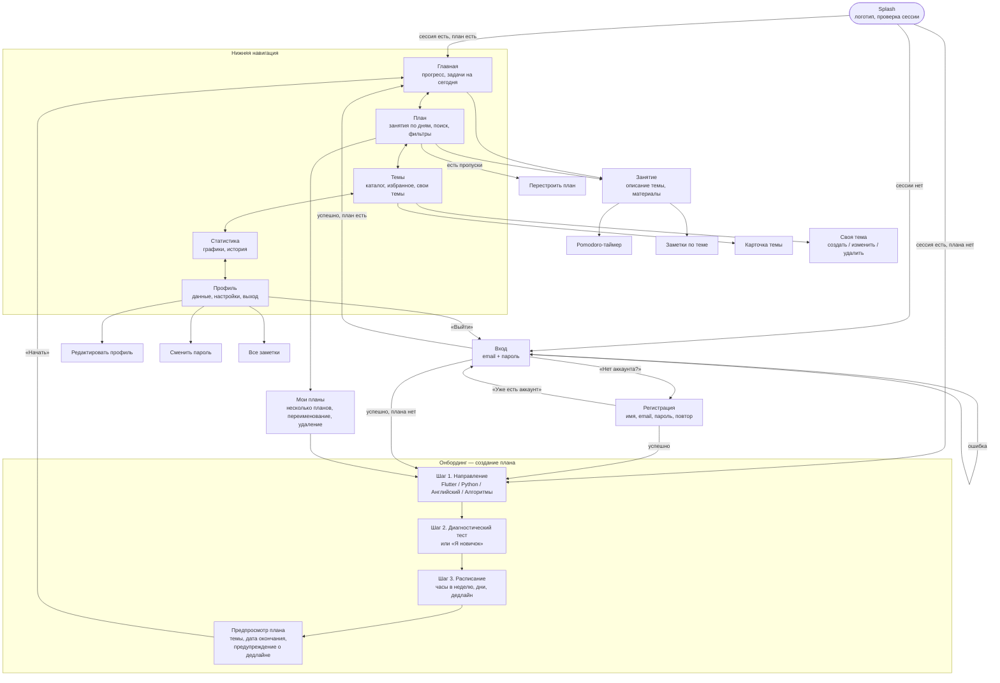
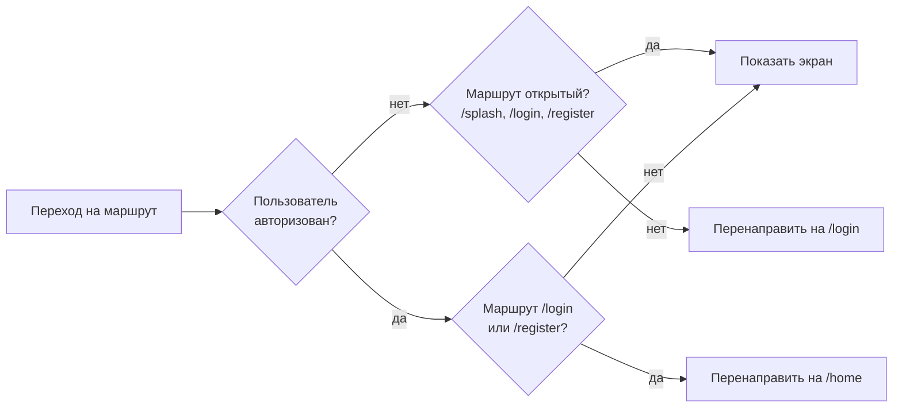
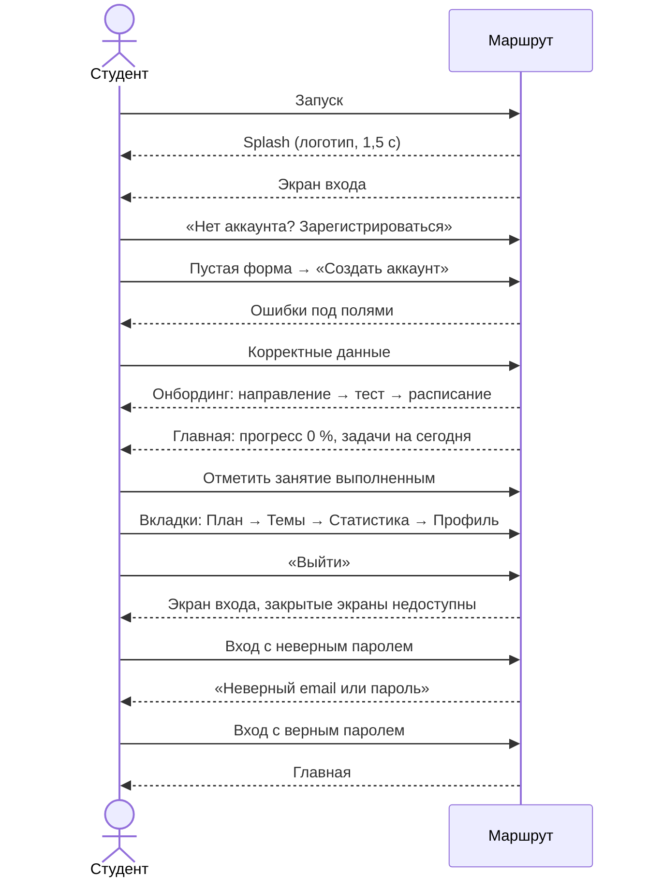

# User flow приложения «Маршрут»

Схема показывает основные экраны и переходы между ними. Диаграммы в формате Mermaid отображаются на GitHub и в большинстве редакторов Markdown (например, VS Code с расширением Markdown Preview Mermaid Support).

## 1. Общий сценарий

## 2. Правила доступа (go_router redirect)

После нажатия «Выйти» сессия удаляется, срабатывает `redirect`, и любой закрытый экран (например, `/home` или `/profile`) становится недоступен до повторного входа.

## 3. Сценарий для демонстрации (1 семестр)

