## 1. Готовность мобильного приложения

### 1.1. Приложение полностью реализовано и работоспособно

В приложении есть все экраны из плана: заставка, регистрация, вход, онбординг из трёх шагов (направление, тест, расписание), предпросмотр плана, главная, план, мои планы, занятие, Pomodoro, темы и свои темы, заметки, статистика, профиль, редактирование профиля, смена пароля и удаление аккаунта. Приложение работает вместе с сервером, который запускается на ноутбуке.

Экраны лежат в папке `lib/presentation/screens/`, переходы между ними — в `lib/core/router/app_router.dart`.

### 1.2. Все функции реализованы и протестированы

На все основные функции есть автоматические тесты: алгоритм построения плана, проверка полей ввода, хэширование паролей, клиент API, сервер API, экраны и сквозной сценарий «Заставка → Регистрация → Вход → Главная → План → Профиль → Выход». Тесты лежат в папке `test/`, сквозной сценарий — в `integration_test/app_test.dart`.

Проверка 04.11.2026 (Linux, Flutter 3.47.7, Dart 3.13.5 — та же версия, на которой собирается проект):

Таблица 1 — Результаты тестов

| Что проверял | Команда | Результат |
|---|--------|----------|
| Все тесты | `flutter test` | 137 тестов, прошло 137, не прошло 0 |
| — алгоритм (test/domain) | | 32 из 32 |
| — проверка полей, пароли, доступ (test/core) | | 26 из 26 |
| — клиент API и репозитории (test/data) | | 35 из 35 |
| — сервер API (test/server) | | 23 из 23 |
| — экраны и сквозной сценарий (test/presentation) | | 21 из 21 |
| Интеграционный тест в окне Linux | `flutter test integration_test -d linux` | не запускался: на компьютере нет инструментов сборки Linux-приложений (clang++, cmake, ninja, GTK). На GitHub этот тест запускается при каждом изменении |

### 1.3. Нет критических ошибок

Анализатор кода (`flutter analyze`) ответил «No issues found!», все тесты проходят, сервер правильно ответил на все 37 проверочных запросов (пункт 2). Ошибок, которые мешают пользоваться приложением, при проверке не найдено. Ошибки, которые находились раньше, исправлены и записаны в журнал `docs/coursework/bugs_log.md`.

## 2. Работа с базой данных и API

### 2.1. Развёрнута база данных

База данных — SQLite на моём сервере. Сервер запускается на ноутбуке командой `dart run bin/marshrut_server.dart` и сам создаёт файл базы `marshrut_server.sqlite`. В базе девять таблиц: пользователи, планы, темы плана, занятия, свои темы, заметки, избранное, журнал Pomodoro и токены входа. Таблицы описаны в `lib/data/db/app_database.dart`.

### 2.2. Доступ к данным только через API

Приложение само базу не открывает. Все классы для работы с данными (`ApiAuthRepository`, `ApiPlanRepository`, `ApiNoteRepository` и другие) отправляют HTTP-запросы серверу, а уже сервер читает и пишет базу. Клиент API — `lib/data/api/api_client.dart`, репозитории — папка `lib/data/api/`.

### 2.3. Операции с данными

Все четыре операции есть. Я проверил их 04.11.2026 запросами curl к серверу с пустой базой и тестовым пользователем:

- получение (GET): планы, занятия, темы, заметки, профиль, статистика. `GET /api/notes` и `GET /api/notes/1` ответили 200;
- добавление (POST): регистрация, план, заметка, своя тема, запись Pomodoro. `POST /api/notes` и `POST /api/custom-topics` ответили 201;
- редактирование (PUT): заметка, своя тема, профиль, пароль, название и настройки плана, отметка занятия. `PUT /api/notes/1` и `PUT /api/custom-topics/custom_1` ответили 204, при повторном чтении пришёл новый текст;
- удаление (DELETE): заметка, своя тема, план со всеми занятиями, аккаунт со всеми данными. Удаление заметки и своей темы ответило 204, после этого запись не находится (404).

Обработчики запросов — в `lib/server/api_server.dart`. Полный журнал всех 37 запросов и ответов — в файле `docs/Проверка_API_КР_2.md`.

### 2.4. Обработка ответов API и ошибок

Сервер отвечает кодами: 200, 201, 204 — успех; 400 — неверные данные; 401 — пользователь не вошёл или токен устарел; 404 — запись не найдена или чужая; 500 — ошибка на сервере.

Что проверено запросами:

- 400: повторная регистрация с тем же email, неверный пароль, заметка без заголовка, тело запроса не JSON, тема короче 30 минут;
- 401: без токена, с неверным токеном, со старым токеном после выхода;
- 404: удалённая запись, несуществующая запись, неверный адрес, чужая заметка (второй пользователь не может прочитать или удалить заметку первого).

Ошибку 500 вручную я не вызывал — для этого надо сломать базу. Её проверяет автоматический тест сервера («сбой базы»).

Приложение на ошибки реагирует так: показывает текст ошибки внизу экрана; при 401 возвращает на экран входа; если сервер выключен — пишет «Нет связи с сервером»; если сервер не ответил за 10 секунд — «Сервер … не отвечает». Это проверено тестами клиента API и экранов. Разбор ответов — `lib/data/api/api_client.dart`.

## 3. Пользовательский интерфейс

Прототипы 16 экранов сделаны до разработки: кликабельные макеты в файле `docs/concept/wireframes.html` и схема переходов в `docs/concept/user_flow.md`. Ссылки на проект в Figma в репозитории нет. [ПРОВЕРИТЬ: ссылка на макет Figma — если макет в Figma есть, вставить ссылку сюда; если нет, уточнить у руководителя, засчитываются ли эти макеты как прототип]

Для сравнения я снял каждый экран макета в браузере и поставил рядом снимок того же экрана приложения (рисунки 1–16, слева макет, справа приложение).

### 3.1. Структура экранов

Все 16 экранов макета есть в приложении, с теми же названиями и тем же содержанием. Ещё несколько экранов добавились по заданию 2 семестра: заметки, своя тема, настройки плана, смена пароля, удаление аккаунта.

### 3.2. Расположение элементов

Основные элементы стоят на тех же местах: заголовок вверху, кольцо прогресса и занятия на сегодня на главной, поиск и фильтры над списком тем, круглый таймер в центре Pomodoro, кнопка действия внизу. Небольшие отличия — в таблице 2.

### 3.3. Логика навигации

Переходы такие же, как в схеме: Заставка → Вход или Главная → Регистрация → Онбординг (направление, тест, расписание) → Предпросмотр → Главная. Внизу пять вкладок с теми же названиями: Главная, План, Темы, Статистика, Профиль. Переходы — `lib/core/router/app_router.dart`.

### 3.4. Цветовая схема и типографика

Цвета взяты из макета без изменений: тёмно-синий `#1A3A8F`, тёмный фон `#0F1D3D`, оранжевый `#F57C00` для кнопок и активной вкладки. Шрифт системный, как в макете (на Android — Roboto), заголовки жирные. Цвета заданы в `lib/core/theme/app_theme.dart`.

### 3.5. Изменения дизайна и их обоснование

Все отличия от макета записаны в таблице 2, у каждого есть причина. Это дополнения по заданиям 2 семестра или для удобства, а не замена дизайна.

Таблица 2 — Отличия экранов от макета

| № | Экран | Что отличается и почему |
|--|--------|--------------------------|
| 1 | Splash | Нет кнопки «Далее (автопереход)»: в макете она только изображала переход, в приложении он происходит сам. Вместо надписи «Проверяем сессию…» крутится индикатор загрузки |
| 2 | Вход | Добавлены значки в полях, кнопка «показать пароль» и кнопка «Сервер: …» для ввода адреса сервера (появилась вместе с API) |
| 3 | Регистрация | Те же поля и кнопки, добавлены подзаголовок и значки в полях |
| 4 | Онбординг: направление | Вместо буквы в квадрате — значок и короткое описание направления. Сверху подписаны шаги |
| 5 | Онбординг: тест | Варианты ответа с кружками выбора, остальное так же |
| 6 | Онбординг: расписание | Добавлены «Начало обучения» и переключатель «Есть дедлайн»: срок стал необязательным, потому что он есть не у всех |
| 7 | Предпросмотр плана | Предупреждение о дедлайне показывается, только когда план не успевает (на снимке успевает). Кнопка «Изменить расписание» ниже, под списком тем |
| 8 | Главная | Карточка прогресса тёмно-синяя, в заголовке значок Pomodoro |
| 9 | План | Вместо круглой кнопки «Перестроить» — кнопка в баннере «Пропущено N занятий». «Мои планы» открываются значком в заголовке. Добавлена полоса прогресса |
| 10 | Мои планы | Кнопка «Новый план» в правом нижнем углу (плавающая кнопка). В карточке добавлены расписание и процент |
| 11 | Занятие | Добавлены блок «Как повторять» и звёздочка «в избранное» |
| 12 | Pomodoro | Добавлен выбор режима 25/5 или 50/10 минут и подсказка о технике |
| 13 | Темы | Сверху вкладки направлений, кнопка добавления подписана «Своя тема» |
| 14 | Статистика | Добавлена круговая диаграмма по категориям и подписи осей |
| 15 | Профиль | Добавлены карточки «планы, занятия, часы», строка «Сервер API» и выбор темы оформления |
| 16 | Редактирование профиля | Снимка приложения нет. Поля те же: имя, email, цвет аватара, кнопка «Сохранить». [ПРОВЕРИТЬ: показать экран на телефоне] |

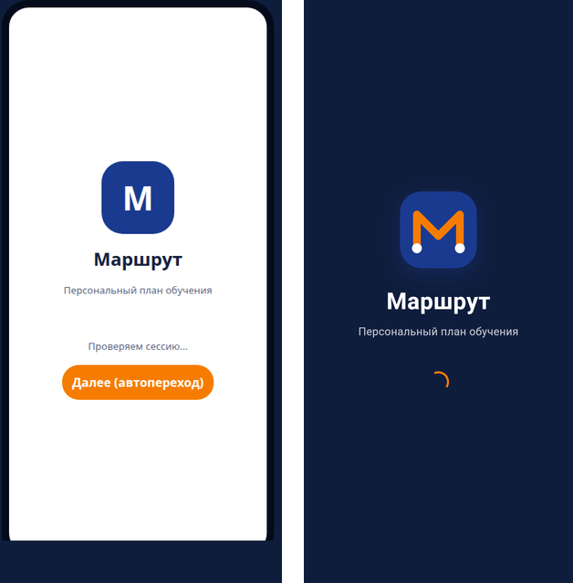

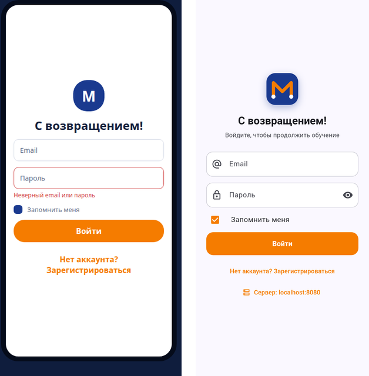

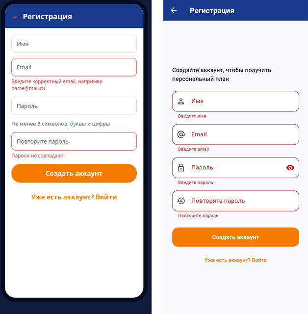

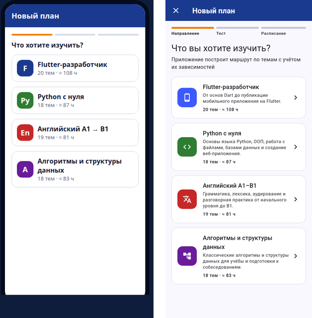

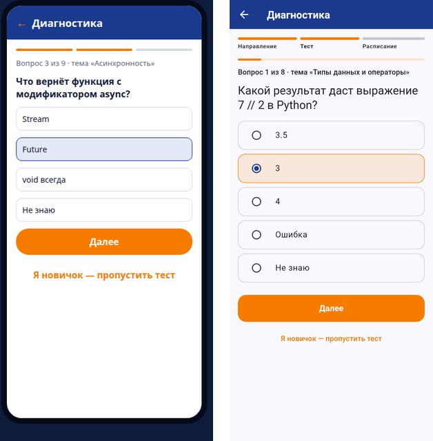

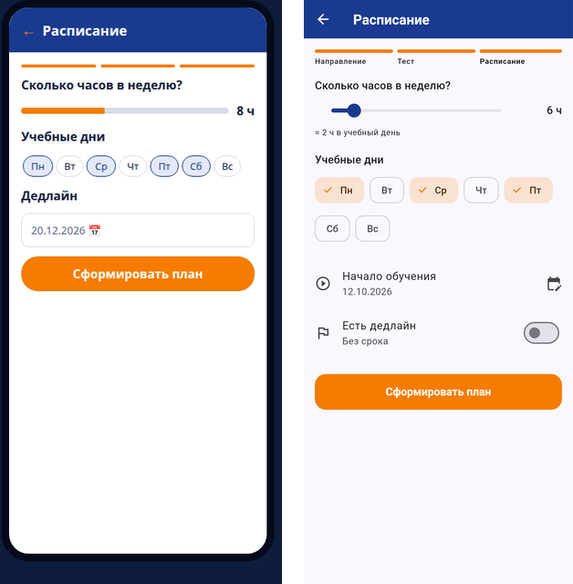

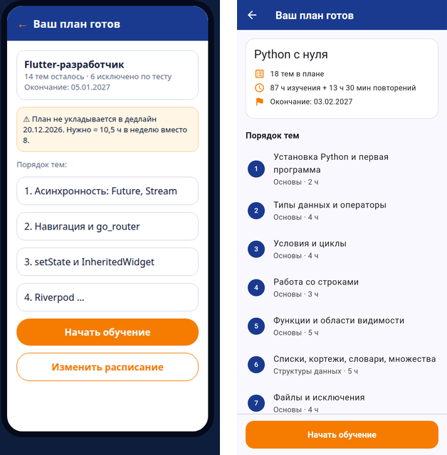

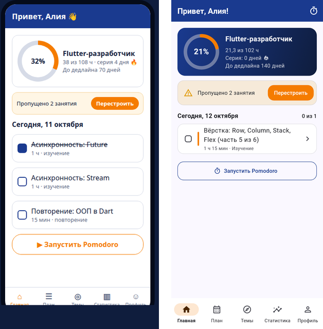

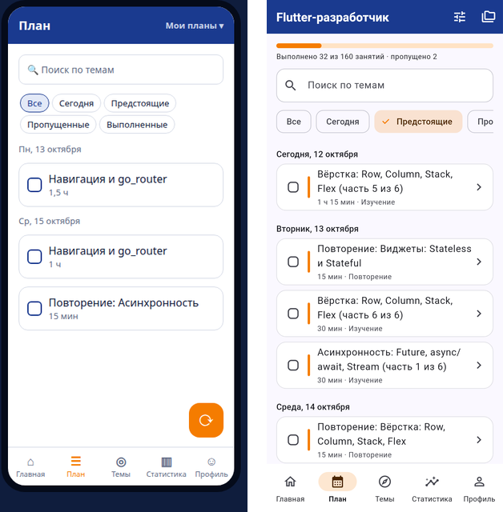

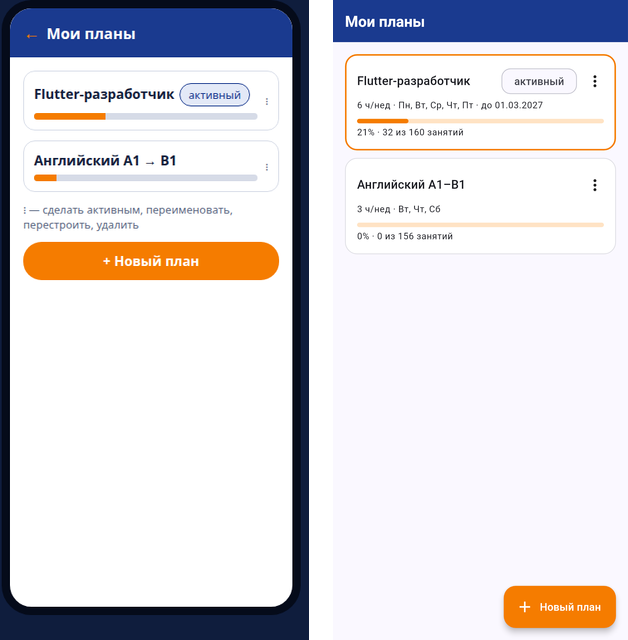

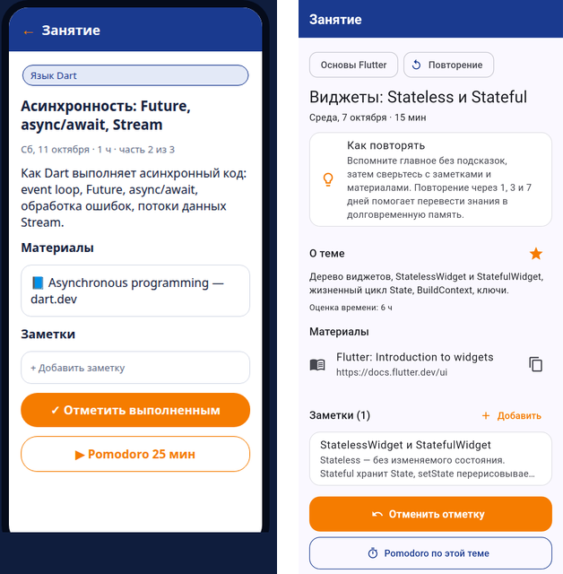

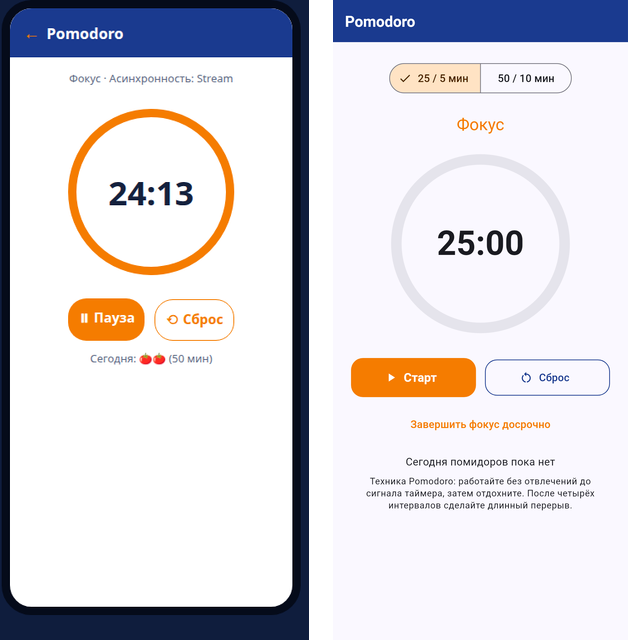

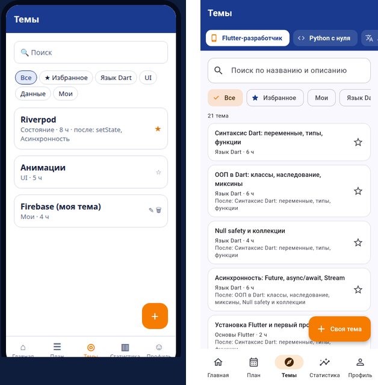

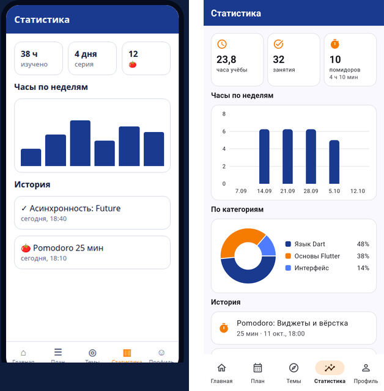

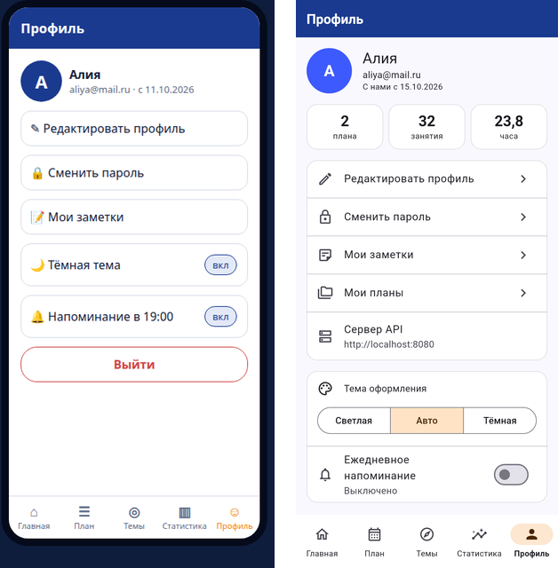

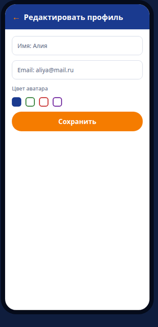

## 4. Установка приложения

### 4.1. Установка на реальный смартфон

Файлы для установки: `marshrut-release.apk` для Android и `marshrut-ios.ipa` для iPhone. Они собираются на GitHub (вкладка Actions). Как установить, написано в `docs/Установка_на_iPhone.md` и в разделе «Android» в README. [ПРОВЕРИТЬ: установить на свой телефон — при проверке 04.11.2026 установка на телефон не делалась]

### 4.2. Демонстрация в рабочем состоянии

Телефон подключается к серверу на ноутбуке по Wi-Fi, адрес сервера вводится на экране входа кнопкой «Сервер: …». Как подключить, написано в `docs/Сервер_API.md`. Эмулятор для демонстрации не используется. [ПРОВЕРИТЬ: пройти демонстрацию на телефоне]

## 5. Требования к результату

1. Установленное и работающее мобильное приложение — пункт 4. [ПРОВЕРИТЬ: установить на свой телефон]
2. Доступ к API — локальный: сервер на ноутбуке, телефон обращается к нему по Wi-Fi (пункт 2).
3. Демонстрация соответствия интерфейса прототипам — пункт 3, таблица 2 и рисунки 1–16. [ПРОВЕРИТЬ: ссылка на макет Figma]
4. Готовность к практическому использованию — все функции работают, 137 тестов из 137 проходят, критических ошибок нет (пункт 1).

## 6. Формат защиты

### 6.1. Демонстрация на смартфоне

На телефоне: заставка → вход (кнопка «Сервер: …» с адресом ноутбука) → главная с кольцом прогресса и занятиями на сегодня → отметка занятия выполненным → вкладки План, Темы, Статистика → Профиль → Выйти.

### 6.2. Работа с данными через API

Окно сервера на ноутбуке стоит рядом с телефоном. В «Моих заметках» создаю, меняю и удаляю заметку — в окне сервера видно `POST /api/notes → 201`, `GET → 200`, `PUT → 204`, `DELETE → 204`. Потом останавливаю сервер (Ctrl+C) и пробую сохранить заметку — приложение не падает и пишет «Нет связи с сервером». Запускаю сервер снова — всё работает.

### 6.3. Архитектура и взаимодействие компонентов

Приложение разделено на три слоя:

- `presentation` — экраны и провайдеры Riverpod. Экраны подписаны на провайдеры, и после изменения данных списки обновляются сами;
- `domain` — сущности и алгоритм построения плана. Темы связаны зависимостями, известные по тесту темы убираются, остальные сортируются алгоритмом Кана и раскладываются по учебным дням с лимитом часов, потом добавляются повторения через 1, 3 и 7 дней. Этот слой не зависит от Flutter и сервера;
- `data` — клиент API и репозитории, которые отправляют запросы на сервер.

Сервер — отдельная программа на Dart (библиотека shelf) с базой SQLite (библиотека drift). Как они связаны: экран → провайдер → репозиторий → HTTP-запрос → сервер → база, и ответ обратно тем же путём.

Как сервер узнаёт пользователя: после входа он выдаёт токен, приложение отправляет его с каждым запросом в заголовке `Authorization: Bearer …`. Сервер проверяет токен и то, что запись принадлежит этому пользователю, и только потом обращается к базе. Пароли хранятся только в виде хэша (PBKDF2-HMAC-SHA256, 100 000 повторений, соль 16 байт).
